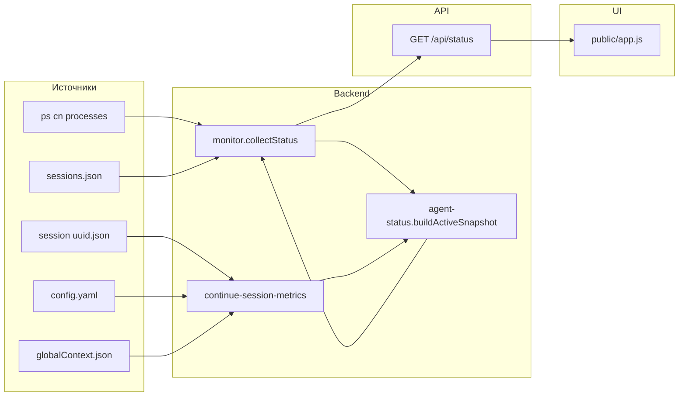

# Архитектура Continue Monitor

Документ описывает, **как устроена** текущая реализация мониторинга Continue CLI.

## 1. Назначение

Read-only веб-панель:

- видит процессы Continue CLI (`cn`);
- читает session JSON на диске;
- эвристически определяет фазу агента и % заполнения контекста;
- показывает live-дашборд в браузере.

Запуск/остановка заданий, запись в Continue — **вне скоупа**.

## 2. Стек и деплой

| Слой | Технология |
|------|------------|
| Runtime | Node.js ≥22, ES Modules |
| HTTP | Express 5 |
| Frontend | vanilla HTML/CSS/JS |
| Auth | Bearer `MONITOR_TOKEN` (≥32 символов) |
| Bind | только loopback `127.0.0.1` / `::1` |
| Service | systemd `continue-monitor.service` |
| Port | `MONITOR_PORT` (по умолчанию `8788`) |

Конфиг: [`src/config.js`](src/config.js) (+ `.env` в cwd).

## 3. Карта модулей

```
continue-monitor/
├── src/
│   ├── server.js                 # Express: /api/health, /api/status, static
│   ├── config.js                 # host/port/token + пути ~/.continue
│   ├── security/auth.js          # Bearer token
│   ├── routes/status.js          # GET /api/status/
│   ├── services/
│   │   ├── monitor.js            # collectStatus() — оркестратор
│   │   └── agent-status.js       # фазы + overlays → active
│   └── adapters/
│       ├── continue-sessions.js  # sessions.json (индекс)
│       ├── continue-processes.js # ps → cn-процессы
│       └── continue-session-metrics.js  # session JSON, usage, tools, overlays
└── public/
    ├── index.html
    ├── app.js                    # poll 3s, рендер
    └── styles.css
```

## 4. Поток данных



1. `collectStatus()` параллельно читает сессии и процессы.
2. `buildActiveSnapshot()` выбирает активную сессию (по `cwd` процесса ↔ `workspaceDirectory`, иначе самый свежий session-файл).
3. Метрики сессии + эвристики → блок `active`.
4. UI опрашивает API каждые ~3 секунды.

## 5. Контракт API

### `GET /api/health` (auth)

```json
{ "ok": true, "service": "continue-monitor", "time": "ISO-8601" }
```

### `GET /api/status/` (auth)

```json
{
  "collectedAt": "ISO-8601",
  "sessions": {
    "available": true,
    "count": 0,
    "sessions": [
      {
        "id": "uuid",
        "title": "string",
        "dateCreated": "ISO-8601|null",
        "workspaceDirectory": "string|null",
        "messageCount": 0
      }
    ],
    "error": null
  },
  "processes": {
    "available": true,
    "processes": [
      {
        "pid": 1,
        "ppid": 1,
        "user": "ubuntu",
        "state": "Sl+",
        "elapsed": "01:23",
        "cpu": "3.0%",
        "mem": "10%",
        "isWorking": false,
        "cwd": "/path",
        "executable": "node"
      }
    ],
    "error": null
  },
  "active": {
    "sessionId": "uuid|null",
    "title": "string|null",
    "workspaceDirectory": "string|null",
    "contextPercent": 0,
    "promptTokens": 0,
    "contextLength": 200000,
    "model": "MiniMax-M2.7",
    "agentStatus": "waiting",
    "agentDetail": "string|null",
    "statusLabel": "Ожидает ввода",
    "elapsed": "01:23",
    "processCount": 1,
    "isResponding": false,
    "phase": "waiting",
    "phases": ["waiting", "thinking", "..."],
    "thinkSnippet": "string|null",
    "lastUserMessage": "string|null",
    "activity": [
      { "name": "Read", "status": "done", "kind": "reading", "target": "/path", "isMcp": false }
    ],
    "ageMs": 1234,
    "overlays": {
      "compacting": { "active": false, "detail": null },
      "subagent": { "active": false, "detail": null },
      "skills": { "active": false, "detail": null },
      "mcp": { "active": false, "detail": null }
    }
  }
}
```

## 6. Источники правды на диске

| Путь | Роль |
|------|------|
| `~/.continue/sessions/sessions.json` | индекс сессий |
| `~/.continue/sessions/<uuid>.json` | history, toolCallStates, usage |
| `~/.continue/config.yaml` | `contextLength` моделей |
| `~/.continue/index/globalContext.json` | `cliSelectedModel` |
| `ps` по args с `@continuedev/cli` / `/bin/cn` | живые процессы |

### Контекст %

```
contextPercent = min(100, round(last_prompt_tokens / contextLength * 100))
```

Берётся **последний** `message.usage.prompt_tokens` в history, не top-level кумулятивный `usage.promptTokens`.

## 7. Модель фаз

Continue **не экспортирует** готовый enum фаз. Монитор строит его сам.

### Основная фаза (взаимоисключающая)

Реализована в [`src/services/agent-status.js`](src/services/agent-status.js) → `deriveStatus()`.

Порядок приоритета (упрощённо):

1. нет процессов → `idle`
2. open tools `AskQuestion` → `aligning`
3. open tools status `generated` → `awaiting_confirmation`
4. open tools по kind → `reading` / `editing` / `planning` / `analyzing` / `running_commands`
5. session не свежий и нет open tools → `waiting` (или `aligning`, если текст — предложение вариантов)
6. иначе по last tools / think / visible text → planning / reading / analyzing / thinking / responding

**Свежесть сессии:** `ageMs < 20000` (mtime session JSON).  
**isWorking:** CPU процесса > 5% — вспомогательный сигнал, не имя фазы.

Классификация tools: [`continue-session-metrics.js`](src/adapters/continue-session-metrics.js)

| kind | Tools |
|------|--------|
| reading | Read, List, LS, Glob, Fetch |
| analyze | Grep, Search, Find |
| align | AskQuestion |
| plan | Checklist |
| edit | Write, Edit, MultiEdit, Delete |
| command | Bash, Terminal |

### Параллельные overlays

Реализованы в `buildOverlaysFromSignals()` — **не** входят в `PHASES`, могут быть активны вместе с любой основной фазой.

| Overlay | Детекция |
|---------|----------|
| compacting | sessionFresh + regex compaction/сжатия в think/тексте |
| subagent | tool `Subagent` (open или свежий last step) |
| skills | tool `Skills` |
| mcp | имя не из Continue builtins / `mcp*` / `__` |

## 8. Frontend

[`public/app.js`](public/app.js):

- Bearer token в `localStorage`
- poll `/api/status/` каждые 3 с
- трек фаз подсвечивает `active.agentStatus`
- чипы overlays — `active.overlays.*.active`
- лента `activity` (последние tools)
- детали процессов/сессий в сворачиваемом блоке

Визуально: кольцо контекста, pulse статуса, phase-track, блок «Параллельно».

## 9. Безопасность

- Слушает только localhost
- Все `/api/*` за `requireAuth`
- Static отдаёт только `public/`
- В монитор **не** попадают apiKey из `config.yaml` (читается только `name` + `contextLength`)

## 10. Операционка

```bash
sudo systemctl restart continue-monitor
sudo systemctl status continue-monitor
journalctl -u continue-monitor -n 50 --no-pager
```

Smoke:

```bash
cd /home/ubuntu/server/continue-monitor
node -e "import { collectStatus } from './src/services/monitor.js'; \
  console.log(JSON.stringify((await collectStatus()).active, null, 2))"
```

## 11. Границы системы

**Есть:** live-статус, контекст %, фазы, overlays, лента tools, список процессов/сессий.

**Нет (пока):** dwell-time по фазам; точный tokenizer Continue; запись/управление `cn`; надёжный live `isCompacting` без эвристики; зависимость от `cn serve /state`.
